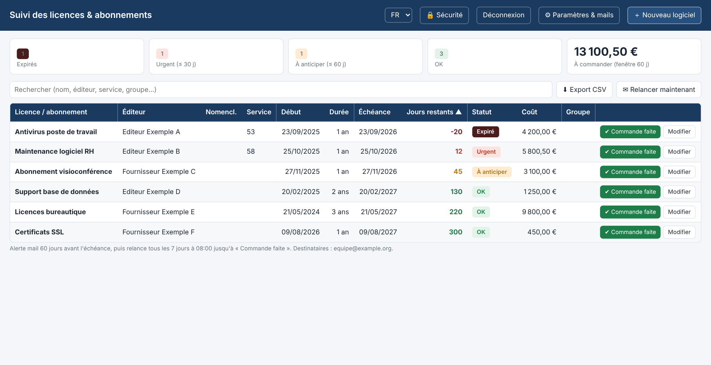
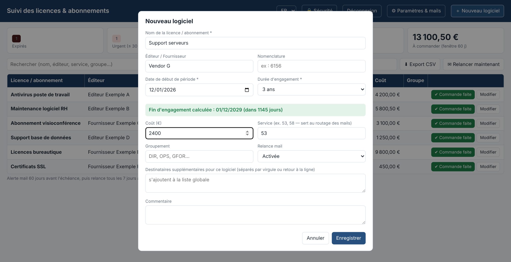
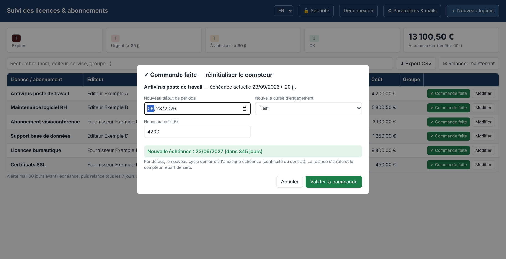
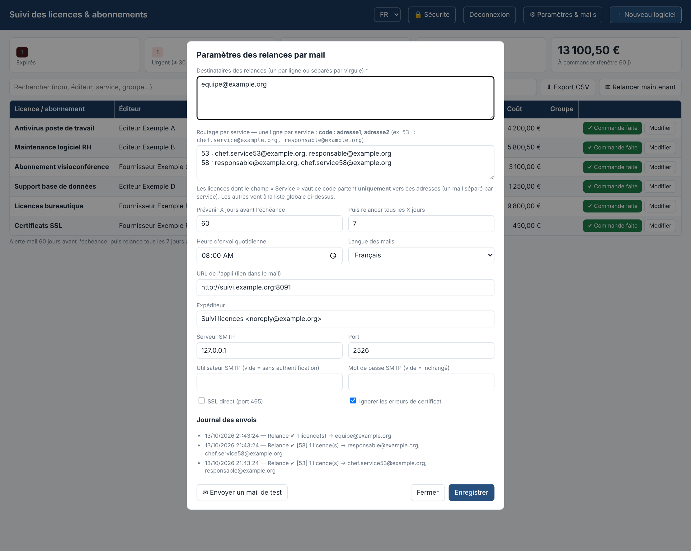
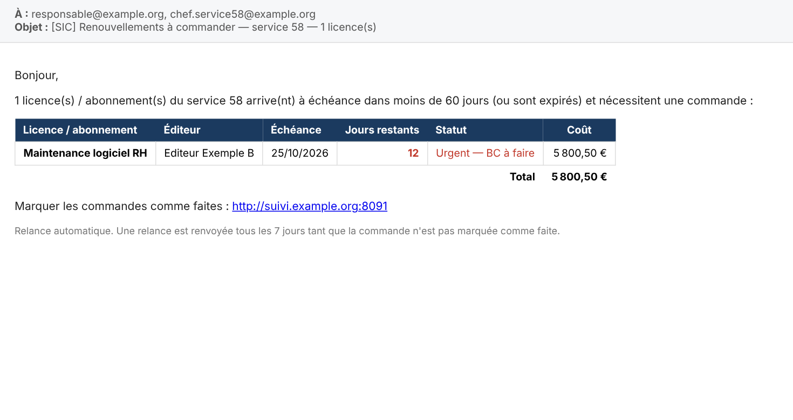

# Suivi des licences & abonnements

Petite application web auto-hébergée pour **suivre les échéances de licences, maintenances et abonnements logiciels**, et **relancer par mail** quand il faut passer commande. Aucune base de données ni framework : un serveur Node et un fichier JSON.

## Aperçu

Tableau de bord avec statuts, compteurs et montant à commander :



Ajout d'un logiciel : la fin d'engagement se calcule toute seule selon la durée choisie (1, 2 ou 3 ans) :



« Commande faite » : le compteur repart sur une nouvelle période et les relances s'arrêtent :



Paramètres : destinataires, routage par service, SMTP et journal des envois :



Mail de relance reçu par les destinataires du service concerné :



## Fonctionnalités

- **Durée d'engagement** de 1, 2 ou 3 ans : la date de fin est calculée automatiquement à partir du début de période.
- **Statuts automatiques** : `OK`, `À anticiper` (dans la fenêtre d'alerte, 60 jours par défaut), `Urgent` (30 jours ou moins), `Expiré`.
- **Relances par mail** via un relais SMTP : un premier mail à J-60 (réglable), puis une relance tous les 7 jours (réglable) tant que la commande n'est pas faite.
- **Bouton « Commande faite »** : repart d'une nouvelle période (par défaut à l'ancienne échéance), remet le compteur à zéro, arrête les relances et garde l'historique.
- **Plusieurs destinataires**, avec un **routage par service** : les licences d'un service (ex. `53`, `58`) sont envoyées à des destinataires dédiés, dans un mail séparé. Destinataires supplémentaires possibles par licence.
- Ajout / modification / suppression de logiciels, recherche, tri, filtre par statut, export CSV.
- Bouton « Relancer maintenant », mail de test et journal des envois.

## Installation

L'application tient dans un seul dossier : `server.js`, `public/index.html` et un fichier de données `data/data.json` créé au premier lancement. Elle a besoin de **Node.js 18 ou plus** et d'un accès réseau vers un **relais SMTP** pour envoyer les mails.

Choisir son installation :

| Environnement | Section |
|---|---|
| NAS Synology (DSM) | [Installation sur un NAS Synology](#installation-sur-un-nas-synology) |
| Serveur ou poste Linux, macOS | [Linux / macOS](#linux--macos) |
| Windows | [Windows](#windows) |
| Docker | [Docker](#docker) |

Dans tous les cas, finir par [la première configuration](#première-configuration).

### Installation sur un NAS Synology

**1. Installer Node.js.** Dans DSM : *Centre de paquets* > chercher **Node.js** (v18 ou plus) > Installer.

**2. Activer SSH.** *Panneau de configuration* > *Terminal et SNMP* > cocher *Activer le service SSH*. Se connecter ensuite depuis un terminal :

```bash
ssh votre-utilisateur@adresse-du-nas
```

**3. Copier l'application sur le NAS.** Télécharger ce dépôt, puis déposer le dossier `suivi-licences` dans un dossier partagé, par exemple `/volume1/web/suivi-licences` (avec *File Station*). Vérifier :

```bash
cd /volume1/web/suivi-licences
ls
```

On doit voir `server.js`, `package.json` et le dossier `public`.

**4. Installer la dépendance** (nodemailer, pour l'envoi des mails) :

```bash
npm install --omit=dev
```

> **Le NAS n'a pas accès à Internet ?** Lancer `npm install --omit=dev` sur un PC, puis copier le dossier `node_modules` obtenu dans le dossier de l'application sur le NAS. La dépendance est du JavaScript pur : elle fonctionne sur n'importe quelle plateforme.

> **Attention :** `npm install` peut prendre une à deux minutes. Attendre que l'invite de commande revienne avant de taper la suite, sinon les commandes se mélangent à l'affichage.

**5. Tester en direct** (en précisant **toujours le port** dans la commande) :

```bash
PORT=8091 node server.js
```

Le message `Suivi licences sur http://0.0.0.0:8091` doit s'afficher. Ouvrir `http://adresse-du-nas:8091` dans un navigateur. Arrêter avec `Ctrl+C`.

> **Toujours écrire `PORT=...` dans la commande.** Si une autre application du NAS a laissé une variable `PORT` dans votre session, le serveur la reprend en silence et peut prendre la place d'une autre application. Le message de démarrage affiche le port réellement utilisé : le vérifier.

**6. Lancer en tâche de fond** pour que le serveur survive à la fermeture de SSH :

```bash
cd /volume1/web/suivi-licences
PORT=8091 nohup node server.js >> suivi.log 2>&1 &
sleep 2
curl -s http://127.0.0.1:8091/api/state | head -c 100
```

Un début de JSON (`{"today":"..."`) confirme que le serveur répond.

**7. Démarrage automatique et relance en cas de plantage.** Le script `lancer.sh` vérifie que le serveur répond et le relance sinon. Le planifier toutes les 5 minutes : *Panneau de configuration* > *Planificateur de tâches* > *Créer* > *Tâche planifiée* > *Script défini par l'utilisateur* :

- **Utilisateur** : le même que celui qui a installé l'application
- **Planification** : tous les jours, avec *Répéter* toutes les **5 minutes**, pendant toute la journée
- **Script** :

```bash
NODE=/usr/local/bin/node PORT=8091 sh /volume1/web/suivi-licences/lancer.sh
```

Trouver le chemin exact de Node avec `which node` (en SSH). Le Planificateur de tâches n'a pas le même `PATH` qu'une session SSH : d'où le chemin complet.

**8. Pare-feu.** Si la page est inaccessible depuis un autre poste alors que `curl` répond sur le NAS : *Panneau de configuration* > *Sécurité* > *Pare-feu* > autoriser le port `8091` pour votre réseau local.

**Arrêter ou redémarrer uniquement cette application** (sans toucher aux autres applications Node du NAS) :

```bash
for p in /proc/[0-9]*; do [ "$(readlink $p/cwd)" = /volume1/web/suivi-licences ] && kill ${p#/proc/}; done
sh /volume1/web/suivi-licences/lancer.sh
```

> `pgrep` et `pkill` n'existent pas sur DSM, et `pkill -f "node server.js"` arrêterait **toutes** les applications Node. La commande ci-dessus ne vise que le dossier de cette application.

### Linux / macOS

```bash
git clone https://github.com/neoloop/logiciels.git
cd logiciels/suivi-licences
npm install --omit=dev
PORT=8091 node server.js
```

Pour un lancement permanent sous Linux avec systemd, créer `/etc/systemd/system/suivi-licences.service` :

```ini
[Unit]
Description=Suivi des licences
After=network.target

[Service]
WorkingDirectory=/opt/suivi-licences
Environment=PORT=8091
Environment=TZ=Europe/Paris
ExecStart=/usr/bin/node server.js
Restart=always
User=suivi

[Install]
WantedBy=multi-user.target
```

```bash
sudo systemctl daemon-reload
sudo systemctl enable --now suivi-licences
```

Sans systemd, `lancer.sh` planifié en cron toutes les 5 minutes fait le même travail :

```cron
*/5 * * * * PORT=8091 /opt/suivi-licences/lancer.sh
```

### Windows

1. Installer [Node.js LTS](https://nodejs.org/).
2. Télécharger ce dépôt, ouvrir un terminal PowerShell dans le dossier `suivi-licences`, puis :

```powershell
npm install --omit=dev
$env:PORT = 8091
node server.js
```

Pour un lancement automatique, créer une tâche dans le *Planificateur de tâches* Windows (déclencheur *Au démarrage*) qui exécute `node.exe server.js` dans le dossier de l'application, ou utiliser un gestionnaire de services comme [NSSM](https://nssm.cc/) ou `pm2`.

### Docker

```bash
cd suivi-licences
docker compose up -d --build
```

Le port `8091` est publié et les données sont conservées dans `./data` (volume monté). Pour changer de port, modifier `ports` dans `docker-compose.yml`.

## Première configuration

Ouvrir `http://adresse-du-serveur:8091`, puis **⚙ Paramètres & mails** :

1. **Serveur SMTP** : adresse et port du relais de messagerie (souvent `25` pour un relais interne, `587` avec authentification, `465` avec *SSL direct* coché). Renseigner l'utilisateur et le mot de passe seulement si le relais l'exige.
2. **Expéditeur** : une adresse acceptée par le relais (certains relais n'autorisent que certaines adresses d'expéditeur).
3. **Destinataires** : les adresses qui reçoivent les relances, une par ligne.
4. **Routage par service** (optionnel) : pour qu'un service reçoive ses propres relances, une ligne par service au format `53 : chef@exemple.org, responsable@exemple.org`. Les licences dont le champ **Service** vaut `53` partent alors uniquement vers ces adresses, dans un mail séparé.
5. **URL de l'appli** : l'adresse de l'application, ajoutée en lien dans les mails pour marquer les commandes comme faites.
6. Cliquer sur **Envoyer un mail de test** pour valider le relais. Les erreurs d'envoi apparaissent dans le *Journal des envois*, en bas de la fenêtre.
7. **Enregistrer**.

Les licences d'exemple servent à tester : les supprimer (*Modifier* > *Supprimer*), puis ajouter les vraies avec **+ Nouveau logiciel**. Renseigner le champ **Service** des licences concernées par le routage.

À partir de là, un mail part chaque jour à l'heure configurée (08:00 par défaut) pour les licences à moins de 60 jours de l'échéance, puis se répète tous les 7 jours jusqu'au clic sur **✔ Commande faite**.

## Mise à jour

Remplacer `server.js` et le dossier `public/` par les nouveaux, **sans toucher au dossier `data/`**, puis redémarrer le serveur (voir plus haut). Avec git :

```bash
git pull
npm install --omit=dev
```

Un navigateur qui garde l'ancienne page en cache se rafraîchit avec `Ctrl+F5`.

## Sauvegarde

Tout l'état (licences, paramètres, journal) est dans `data/data.json`. Le copier régulièrement, par exemple avec la sauvegarde du NAS. Pour restaurer : arrêter le serveur, remettre le fichier, relancer.

## Dépannage

| Symptôme | Cause probable et solution |
|---|---|
| `ERR_CONNECTION_REFUSED` dans le navigateur | Le serveur ne tourne pas. Le lancer à la main (`PORT=8091 node server.js`) et lire l'erreur affichée. |
| `Cannot find module 'nodemailer'` | `npm install --omit=dev` n'a pas été fait dans ce dossier (ou a été interrompu). |
| `EADDRINUSE` | Le port est déjà utilisé. Choisir un autre port : `PORT=8092 node server.js`. |
| Le serveur démarre sur un autre port que prévu (`8090`...) | Une variable `PORT` existe déjà dans la session. Toujours écrire `PORT=8091` dans la commande. |
| Le serveur s'arrête quand SSH se ferme | Lancer avec `nohup ... &` et mettre en place la tâche planifiée `lancer.sh`. |
| `node: command not found` dans la tâche planifiée | Donner le chemin complet : `NODE=/usr/local/bin/node`. |
| Le test de mail échoue | Vérifier le serveur et le port SMTP, le mode SSL, l'authentification, et que l'expéditeur est autorisé sur le relais. Le message exact est dans le journal des envois. |
| Les jours restants ou les statuts sont faux | Vérifier la date et le fuseau du serveur (`date`). Le fuseau se règle avec la variable `TZ`. |
| Aucun mail n'arrive alors que le test passe | Vérifier que le champ **Service** des licences correspond bien à un code de routage, et qu'une licence est à moins de 60 jours de l'échéance. Le bouton **✉ Relancer maintenant** force un envoi. |

## Configuration

| Paramètre | Défaut |
|---|---|
| Serveur SMTP | `smtp.example.org:25`, sans authentification, certificat non vérifié |
| Alerte avant échéance | 60 jours |
| Relance tous les | 7 jours |
| Heure d'envoi quotidienne | 08:00 (fuseau `TZ`, `Europe/Paris` par défaut) |

Variables d'environnement : `PORT` (8091), `DATA_DIR` (`./data`), `TZ`.

## Sécurité

L'application **n'a pas d'authentification** : elle est prévue pour un réseau interne. Ne pas l'exposer sur Internet sans reverse proxy authentifié. Le mot de passe SMTP éventuel est stocké en clair dans `data/data.json` (dossier exclu du dépôt).
