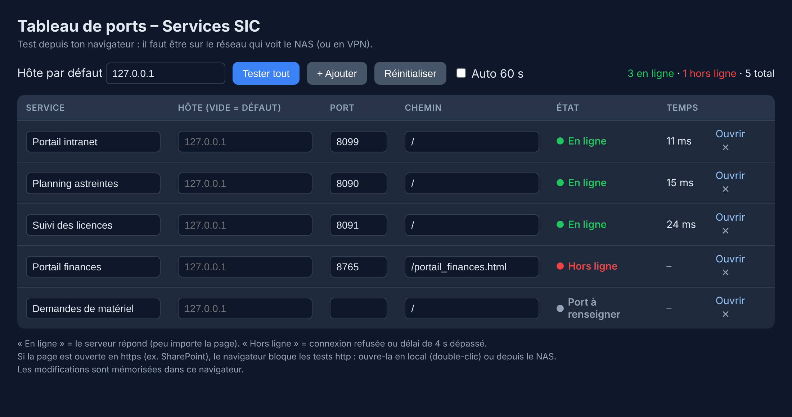
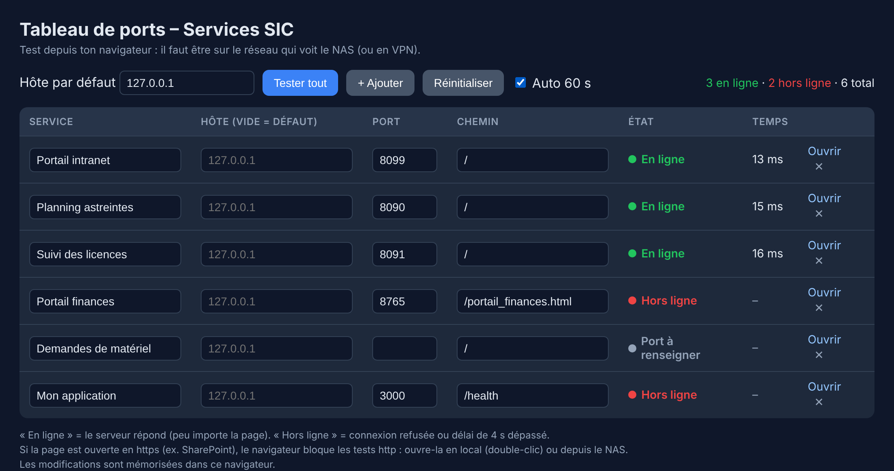

# Port table

🇫🇷 [Français](README.md) · 🇬🇧 English

A single HTML page, **no dependency and no server needed**, that shows at a glance whether your internal web services are up: a service / host / port / path table, an **online / offline** badge, response time and optional auto-refresh.

## Preview

Every service is checked when the page opens:



Add a service, edit host, port and path right in the table, and turn on the automatic check every 60 seconds:



## How it works

- The check runs **in your browser**: it sends an HTTP request to `host:port/path` and measures the response time.
- **Online**: the server answers (whatever the content, even a 404 or 500). **Offline**: connection refused or no answer within 4 seconds.
- The result therefore depends on **where you open the page**: you must be on the network (or VPN) that can reach your servers.
- The list is saved in the browser (`localStorage`). Nothing is sent anywhere.

## Installation

Nothing to install: everything is in `index.html`. Pick one method.

### 1. Locally (simplest)

1. Download [`index.html`](index.html) (« Raw » then Ctrl+S, or `git clone` the repo).
2. Double-click it: the page opens in your browser.
3. Go to [configuration](#configuration).

### 2. On a Synology NAS (Web Station)

1. In **Package Center**, install **Web Station** if needed.
2. In **File Station**, create a `web/tableau-ports` folder and put `index.html` in it.
3. In **Web Station → Web Service → Create**, choose *Static website* and point to that folder.
4. In **Web Station → Web Portal → Create**, pick that service, **HTTP**, and a free port (e.g. `8200`).
5. Open `http://NAS-IP:8200/`.

### 3. With any web server

```bash
# Python (quick test, from the tableau-ports folder)
python3 -m http.server 8200

# nginx: copy index.html into the site root
sudo cp index.html /var/www/html/ports.html
```

### 4. With Docker

```bash
docker run -d --name tableau-ports -p 8200:80 \
  -v "$PWD":/usr/share/nginx/html:ro nginx:alpine
```

Then open `http://localhost:8200/`.

> ⚠️ **Serve the page over HTTP, not HTTPS** (unless your services are HTTPS too): browsers block `http://` requests made from an `https://` page (mixed content), so every check would show « offline ».

## Configuration

1. Set the **default host** (your server's IP or name) at the top.
2. For each row: service name, port and path (`/` or a specific page such as `/health`). Leave « Host » empty to use the default host, or fill it in for another server.
3. **+ Add** for a new row, **✕** to delete it, **Open** to go to the service.
4. **Test all** reruns the checks; tick **Auto 60 s** for continuous monitoring.
5. **Reset** restores the sample list.

To change the default list, edit the `DEFAULTS` constant at the top of the `<script>` in `index.html`.

## Limits

- The check only confirms a **port answers**, not that the application works properly.
- A service that refuses requests from your machine (firewall) shows as « offline » even if it is running.
